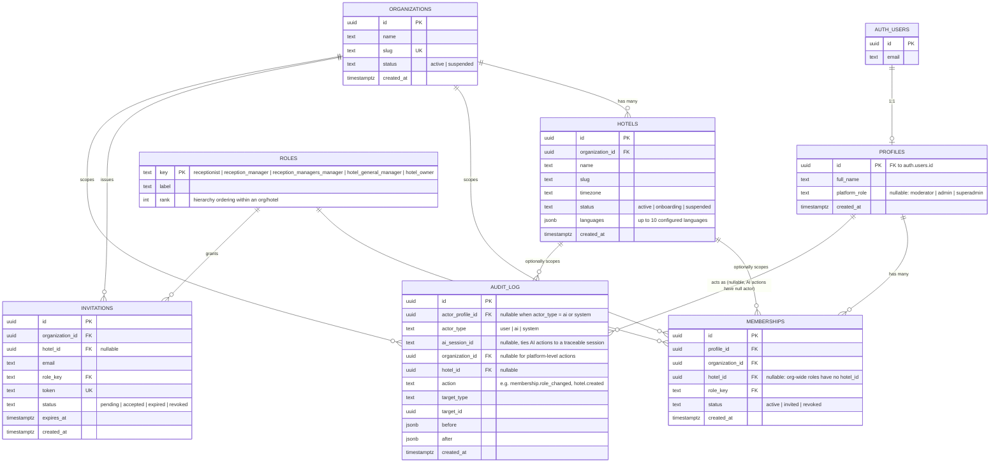
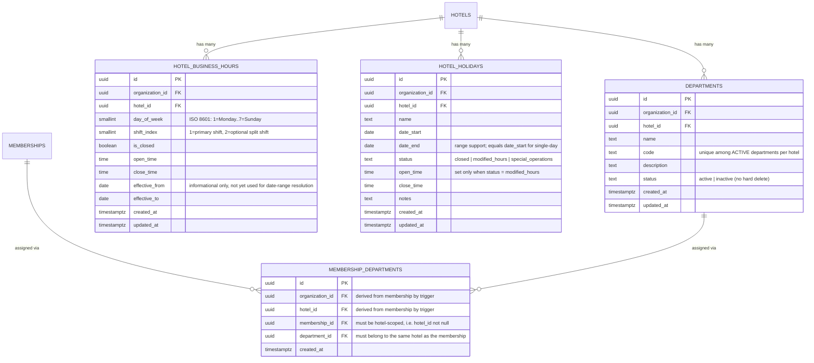

# Spico — Entity Relationship Diagram

Status: Milestone 1 (auth/orgs/hotels/memberships/RBAC/audit), Milestone 2 (hotel profile
fields, departments, business hours/holidays, department assignment), Milestone 3 (AI
agent configuration foundation), Milestone 4 (knowledge base: categories, articles,
documents + Storage, agent knowledge assignment), Milestone 5 (omnichannel inbox
skeleton: channels, conversations, messages), Milestone 6 (reservations & PMS core:
room types, rooms, rate plans, guests, reservations), Milestone 7 (public booking engine:
booking_settings + anon SECURITY DEFINER RPCs), Milestone 8 (voice foundation:
hotel_voice_settings, calls, call_events, call_recordings), Milestone 9 (integrations:
api_keys, webhooks, webhook_deliveries, integrations connector foundation), Milestone 10
(billing/platform administration: plans, organization_subscriptions, platform_settings,
platform_moderation_flags) — every milestone in the original roadmap — and Milestone 11 (PMS
completion: rate_plan_seasons, folios, folio_line_items, folio_payments, housekeeping_tasks,
channel_manager_sync_logs), and Milestone 12 (production readiness: is_test_data columns +
seed/remove-test-data functions, invitation acceptance). M1-M11 are written as SQL migrations
and **have been executed against the live Supabase project** (`cwcmjtglxyojsjzvunsf`) — see
`assumptions.md` for what was applied and verified, including a real access-control fix (M11
#1). M12's migrations are written and pending an explicit sign-off + `db push`.
A small number of entities remain future-only (per-night rate calendars beyond the M11 seasonal
overrides, folio/payment/booking-engine externals, KB vector retrieval) — sketched at the bottom
so the foundation's foreign keys/naming line up later; no migration for them ships yet.

## Milestone 1 entities



## Notes on modeling decisions

- **`profiles` mirrors `auth.users`** (1:1, PK = `auth.users.id`) rather than extending
  Supabase's managed table directly — standard Supabase pattern, keeps app-owned columns
  separate from the auth schema.
- **Platform roles live on `profiles`, not `memberships`.** Platform Moderator/Admin/
  Superadmin operate across every tenant; modeling them as a membership would force either
  a fake "platform org" or per-org rows that don't reflect reality. RLS policies check
  `profiles.platform_role` directly for platform-level access, and org/hotel-scoped
  policies check `memberships` for everything else.
- **`memberships.hotel_id` is nullable** because some roles are naturally org-wide (e.g. a
  Hotel Owner overseeing multiple properties, or a group-level Reception Managers Manager)
  while others (Receptionist, Reception Manager) are always scoped to one hotel. Whether a
  given `role_key` *requires* a `hotel_id` is enforced in `rbac.md`'s permission logic, not
  the schema — keeps the table generic.
- **`roles` is a small reference table, not an enum**, so `rank` (hierarchy depth) and
  `label` can evolve without a migration that rewrites a Postgres enum type.
- **`audit_log.actor_type` distinguishes `user`/`ai`/`system`** so AI-triggered mutations
  (mandatory to log per your rules) are traceable back to an agent/session even though
  there's no human `actor_profile_id`.
- **`hotels.languages`** stores the configured language list (≤10) as `jsonb` for
  Milestone 1; if per-language settings grow complex later (e.g. per-language voice/agent
  config), this can be normalized into its own table without breaking the FK shape here.

## Milestone 2 entities

`hotels` is extended in place (not a parallel 1:1 table — see `assumptions.md`) with:
`updated_at`, `description`, `hotel_type`, `star_rating`, `logo_url`, `cover_image_url`,
`address_line1`, `city`, `country_code`, `postal_code`, `default_currency`,
`default_locale`, `contact_email`, `contact_phone`, `website_url`, `check_in_time`,
`check_out_time`, `default_guest_language` (must be one of `languages`, enforced by a
`jsonb` containment CHECK).



### Notes on Milestone 2 modeling decisions

- **`departments` lifecycle is status-based** (`active`/`inactive`), matching the
  `memberships` convention from M1 (revoke, don't delete) rather than introducing a
  `deleted_at` column. A partial unique index on `(hotel_id, code) WHERE status = 'active'`
  prevents duplicate active codes while still letting a new active department reuse a code
  that was previously deactivated.
- **Departments are seeded exactly once**, via an `AFTER INSERT` trigger on `hotels` (fires
  only at hotel creation). Deactivating or editing a seeded department afterwards can never
  cause it to be recreated, since the trigger never fires again for that hotel.
- **`membership_departments.organization_id`/`hotel_id` are trigger-derived**, not
  caller-supplied — a `BEFORE INSERT` trigger looks them up from the referenced membership
  and rejects the insert outright if the membership isn't hotel-scoped or the department
  belongs to a different hotel. This satisfies the mandatory "every tenant-owned record
  must include organization_id/hotel_id" rule without trusting client input for it.
- **`hotel_business_hours`/`hotel_holidays` are a data foundation, not a scheduling
  engine.** `effective_from`/`effective_to` on business hours are stored but not yet
  consumed by any "what are today's effective hours" resolution logic — that's deferred
  until the AI Agents milestone actually needs to query it. No overnight-spanning hours
  (e.g. a bar open past midnight) are supported yet; `open_time < close_time` is enforced
  within a single calendar day.

## Milestone 3 entities

`ai_agents` is always hotel-scoped (`hotel_id not null`). It also carries three
schedule-mode columns directly (`use_hotel_business_hours`, `holiday_behavior`,
`outside_hours_behavior`) rather than a separate 1-row settings table, since they're
inherently scalar agent properties. Every child table below derives `organization_id`/
`hotel_id` from `agent_id` via a shared `BEFORE INSERT` trigger
(`set_ai_agent_child_scope()`), the same pattern as M2's `membership_departments`.

```mermaid
erDiagram
    HOTELS ||--o{ AI_AGENTS : "has many"
    AI_AGENTS ||--o{ AI_AGENT_LANGUAGES : "has many"
    AI_AGENTS ||--o{ AI_AGENT_CAPABILITIES : "has many"
    AI_AGENTS ||--o{ AI_AGENT_SCHEDULES : "has many (override rows)"
    AI_AGENTS ||--o| AI_AGENT_HANDOFF_RULES : "has one"
    AI_AGENTS ||--o| AI_AGENT_APPROVAL_POLICIES : "has one"
    AI_AGENTS ||--o{ AI_AGENT_PROMPT_VERSIONS : "has many"
    AI_AGENTS ||--o{ AI_AGENT_TEST_SESSIONS : "has many"
    DEPARTMENTS ||--o{ AI_AGENT_HANDOFF_RULES : "primary handoff department"

    AI_AGENTS {
        uuid id PK
        uuid organization_id FK
        uuid hotel_id FK
        text name "unique per hotel"
        text slug "unique per hotel, internal identifier"
        text description
        text agent_type "receptionist | reservations | concierge | night | restaurant | spa | general_information"
        text status "draft | active | inactive | archived"
        operating_mode text "manual_assist | semi_automatic | automatic"
        text default_language "must be one of this agent's enabled languages (app-enforced, see assumptions.md)"
        text personality_tone
        text greeting_message
        text fallback_message
        text handoff_message
        integer current_prompt_version "points to ai_agent_prompt_versions.version_number"
        boolean knowledge_base_enabled
        boolean test_mode_enabled
        boolean use_hotel_business_hours
        text holiday_behavior "follow_hotel | operate_normally | custom_rule"
        text outside_hours_behavior "transfer_reception | transfer_oncall | create_message_request | fallback_message | disable_agent"
        timestamptz created_at
        timestamptz updated_at
        uuid created_by FK
        uuid updated_by FK
    }

    AI_AGENT_LANGUAGES {
        uuid id PK
        uuid agent_id FK
        text language_code
        boolean enabled
        boolean is_default "at most one per agent (partial unique index)"
        text localized_greeting
        text localized_fallback
        text voice_preference "placeholder for a future voice provider"
    }

    AI_AGENT_CAPABILITIES {
        uuid id PK
        uuid agent_id FK
        text capability_key "CHECK against lib/agentCapabilities.ts registry"
        boolean enabled
        boolean approval_required "nullable = inherit registry default"
    }

    AI_AGENT_SCHEDULES {
        uuid id PK
        uuid agent_id FK
        smallint day_of_week "ISO 8601, mirrors hotel_business_hours"
        smallint shift_index
        boolean is_closed
        time open_time
        time close_time
    }

    AI_AGENT_HANDOFF_RULES {
        uuid id PK
        uuid agent_id FK "unique, 1:1"
        boolean handoff_enabled
        uuid primary_department_id FK
        text primary_phone_placeholder
        text backup_phone_placeholder
        boolean condition_guest_requests_human
        boolean condition_low_confidence
        boolean condition_unsupported_language
        boolean condition_emergency
        boolean condition_outside_hours
        boolean condition_capability_disabled
        boolean condition_high_risk
        text handoff_message
        text fallback_when_unavailable
    }

    AI_AGENT_APPROVAL_POLICIES {
        uuid id PK
        uuid agent_id FK "unique, 1:1"
        jsonb approver_roles "subset of the 5 role_key values"
        integer approval_expiry_minutes
        text default_fallback "escalate_to_human | auto_deny | send_fallback_message"
        boolean allow_automatic_low_risk_replies
        boolean guest_visible_messages_require_approval
        boolean reservation_requests_always_require_approval
    }

    AI_AGENT_PROMPT_VERSIONS {
        uuid id PK
        uuid agent_id FK
        integer version_number "unique per agent"
        text purpose
        text hotel_identity
        text tone_of_voice
        text greeting_style
        text communication_rules
        text language_behavior
        text escalation_rules
        text safety_rules "hotel's ADDITIONAL notes, never overrides platform-protected rules in code"
        text policy_references
        text additional_instructions
        boolean is_active "at most one per agent (partial unique index)"
        timestamptz created_at
        uuid created_by FK
    }

    AI_AGENT_TEST_SESSIONS {
        uuid id PK
        uuid agent_id FK
        uuid tested_by FK
        text sample_message
        text test_language
        jsonb simulated_result "config snapshot only — no external call is ever made"
        timestamptz created_at
    }
```



### Notes on Milestone 3 modeling decisions

- **Capability *definitions* (display name, description, default risk level, default
  approval requirement, future tool identifier) live in code**
  (`lib/agentCapabilities.ts`), not a database table — the brief asks for "a reusable
  capability registry rather than hardcoding feature checks," which is a shared constant
  used by both the UI and validation, not necessarily a DB reference table. `ai_agent_capabilities`
  only stores what varies per agent (enabled, an optional approval-requirement override); a
  `CHECK` constraint keeps `capability_key` values in sync with the registry.
- **`human_handoff` and `emergency_escalation` can never be disabled** — enforced by a
  `CHECK` on `ai_agent_capabilities` requiring `enabled = true` whenever `capability_key` is
  one of those two, not just a UI restriction.
- **"Agent needs ≥1 enabled language" and "default language must be enabled" are
  application-enforced, not DB-enforced.** Both are cross-row (or cross-table, for the
  default-language case) invariants that would need a deferred constraint trigger to check
  correctly across a multi-statement update — real complexity that isn't worth the risk
  without a live database to test it against this session (same reasoning as several M1/M2
  simplifications). The create/edit server actions validate the full submitted set with Zod
  before writing. Single-row invariants (e.g. "a row marked default must also be enabled")
  are still enforced with a plain `CHECK`.
- **Prompt versions are immutable and append-only.** Editing hotel-configurable prompt
  fields always inserts a new `ai_agent_prompt_versions` row (never updates an existing
  one) and flips `is_active`. "Restoring" a prior version copies its content into a *new*
  version row rather than resurrecting the old one — history is never lost or reordered.
- **Platform-protected safety rules are not a database column at all.** They live in
  `lib/agentPromptPolicy.ts` as a constant, rendered read-only next to the hotel-editable
  `safety_rules` field so the two are never confused or overridable from the UI.
- **`ai_agent_test_sessions` never triggers a real AI/voice/messaging call** — it's a plain
  append-only log of what the configuration *would* do, computed entirely from the other
  M3 tables.

## Milestone 4 entities — Knowledge Base

```
kb_categories               (id, org_id, hotel_id, name, slug, description, status,
                             created_at, updated_at, created_by)
kb_articles                 (id, org_id, hotel_id, category_id?, article_type, title, summary?,
                             body, language_code, status, timestamps, created_by, updated_by)
kb_documents                (id, org_id, hotel_id, category_id?, title, description?,
                             source_type[file|url], storage_path?, file_name?, file_mime_type?,
                             file_size_bytes?, source_url?, language_code, processing_status,
                             processing_error?, status, timestamps, created_by, updated_by)
ai_agent_knowledge_sources  (id, org_id, hotel_id, agent_id, source_kind[all|category|
                             document|article], category_id?, document_id?, article_id?,
                             created_at, created_by)
```

Plus a private Supabase **Storage** bucket `kb-documents` (25 MB limit, PDF/TXT/MD/CSV/DOC/DOCX
allow-list) with `storage.objects` RLS keyed off the first path segment (the `hotel_id`).

### Notes on Milestone 4 modeling decisions

- **Content vs. authoring split.** `kb_articles` is hand-authored text (FAQ/policy/article/
  snippet); `kb_documents` is file- or URL-backed. `kb_categories` groups both (nullable
  `category_id`, `on delete set null` so removing a category never deletes content).
- **`processing_status` is a foundation for a pipeline that doesn't exist yet.** `ready` means
  "stored and available as a raw source," explicitly **not** "chunked/embedded/vector-indexed."
  No `processing`/`failed` transition is ever written in M4 — there is nothing that processes.
  The future RAG milestone adds the chunk/embed tables (pgvector) and the states that move a
  document through them.
- **Enum-ish columns (`article_type`, `status`, `source_type`, `processing_status`,
  `source_kind`) are DB `CHECK`s, and typed as `string` in `lib/supabase/types.ts`** with the
  narrow unions living in `lib/knowledgeBase.ts` — the same registry-in-code pattern M3 used
  for capabilities, keeping the hand-written DB types codegen-replaceable.
- **`kb_documents` file rows carry `storage_path` from insert time** (the upload action
  generates the document id up front, uploads to `<hotel_id>/<id>/<file>`, then inserts), so a
  single `CHECK` can require `storage_path` for `file` rows and `source_url` for `url` rows. The
  file is uploaded before the row is written and rolled back if the insert fails — no row ever
  points at a missing object.
- **`ai_agent_knowledge_sources` reuses the shared `set_ai_agent_child_scope()` trigger** to
  derive `org_id`/`hotel_id` from the agent, like every other `ai_agent_*` child. A four-way
  `CHECK` enforces that exactly the right target column is set for each `source_kind`, and
  partial unique indexes prevent duplicate assignments (one `all` per agent; each specific
  target at most once per agent).
- **Agent↔source "same hotel" is app-enforced** (the FK only checks existence): the assign
  action verifies the chosen category/document/article belongs to the agent's hotel before
  inserting — the same cross-table category of check as M3's language/default invariants.

## Milestone 5 entities — Omnichannel Inbox

```
channels        (id, org_id, hotel_id, channel_type[email|sms|whatsapp|viber|web_chat|voice],
                 name, identifier?, provider='stub', direction, status, config jsonb,
                 timestamps, created_by)
conversations   (id, org_id, hotel_id, channel_id, subject?, guest_display_name?,
                 guest_identifier?, status[open|pending|snoozed|closed], priority,
                 assignee_membership_id?, assigned_department_id?, ai_agent_id?,
                 last_message_at?, last_message_preview?, timestamps, created_by)
messages        (id, org_id, hotel_id, conversation_id, direction[inbound|outbound],
                 sender_type[guest|user|ai|system], sender_membership_id?, sender_ai_agent_id?,
                 body, delivery_status, external_message_id?, created_at)
```

### Notes on Milestone 5 modeling decisions

- **Skeleton, not a live channel.** `channels.provider` is always `'stub'`; the send path goes
  through a code-level `ChannelAdapter` (`lib/inboxChannels.ts`) that stores messages and
  transmits nothing. No provider credentials, webhooks, or delivery callbacks exist.
- **`messages` derives `org_id`/`hotel_id` from its conversation** via a new shared
  `set_conversation_child_scope()` trigger — the same pattern as `set_ai_agent_child_scope()`.
- **Messages are append-only** (insert + select RLS only). `delivery_status` is a foundation
  for a future provider that reports delivery; outbound rows are stored `sent` and never change.
- **Handling metadata vs. routing.** `assignee_membership_id`/`assigned_department_id`/
  `ai_agent_id` on a conversation record *who should handle it*; no routing/automation engine
  reads them yet. `ai_agent_id` is the seam where M3 agents will later pick up conversations.
- **`inbox.view` carries guest PII**, so it is the one read permission not granted to Platform
  Moderator (see `rbac.md` Milestone 5).

## Milestone 6 entities — Reservations & PMS

```
room_types    (id, org_id, hotel_id, name, code, description?, max_occupancy, base_rate,
               status, timestamps, created_by)
rooms         (id, org_id, hotel_id, room_type_id, room_number, floor?,
               housekeeping_status[clean|dirty|inspected|out_of_service], status, notes?,
               timestamps, created_by)
rate_plans    (id, org_id, hotel_id, room_type_id, name, code, nightly_amount, refundable,
               includes_breakfast, status, timestamps, created_by)
guests        (id, org_id, hotel_id, first_name, last_name, email?, phone?, country_code?,
               vip, notes?, timestamps, created_by)   -- PII
reservations  (id, org_id, hotel_id, confirmation_code, guest_id, room_type_id, room_id?,
               rate_plan_id?, check_in_date, check_out_date, adults, children,
               status[pending|confirmed|checked_in|checked_out|cancelled|no_show],
               total_amount, currency, source, notes?, timestamps, created_by)
```

### Notes on Milestone 6 modeling decisions

- **Book a type, assign a room at check-in.** `reservations.room_id` is nullable until check-in;
  availability is tracked at the room-type level, computed (not stored) as active in-service
  rooms of the type minus overlapping `pending`/`confirmed`/`checked_in` reservations.
- **No per-night inventory table and no exclusion constraint.** Availability and room-assignment
  conflicts are enforced in the server actions (see `assumptions.md` M6 #1–#2). `check_out_date >
  check_in_date` is a DB `CHECK`; `confirmation_code` is unique per hotel.
- **FKs to inventory are RESTRICT where deletion would orphan history** (`guest_id`,
  `room_type_id`), and `SET NULL` for the assignable `room_id`/`rate_plan_id` so removing a room
  or plan doesn't delete the reservation.
- **`rate_plans` is a flat nightly amount per room type** — no seasonal/LOS pricing calendar.
  Reservation total = nights × (rate plan or room-type base rate).
- **Housekeeping is a single per-room status flag** (`clean/dirty/inspected/out_of_service`), set
  to `dirty` automatically on check-out. A full housekeeping workflow is a later milestone.

## Milestone 7 entities — Public Booking Engine

```
booking_settings   (id, org_id, hotel_id UNIQUE, enabled, min_nights, max_nights, terms?,
                    timestamps, created_by)   -- internal-only; public engine reads it via RPC
```

Plus four `SECURITY DEFINER` functions (not tables) that are the entire public API, EXECUTE
granted to `anon`:

```
booking_hotel_public(slug)                              -> public hotel header + enabled + terms
booking_room_type_offers(hotel, in, out, guests)        -> bookable types w/ computed availability + "from" price
booking_rate_plans_public(hotel, room_type)             -> active rate plans for a type
booking_create(hotel, type, plan?, in, out, ad, ch, name/email/phone)
                                                        -> validates + inserts guest & pending reservation, returns code
```

### Notes on Milestone 7 modeling decisions

- **No anon access to base tables.** Guests reach only the four functions above; every one is
  `SECURITY DEFINER` with `search_path = public`, returning derived data only. Availability is
  computed the same way as the internal M6 flow (rooms minus overlapping occupying reservations).
- **`booking_create` is the authoritative overbooking guard** — it re-counts availability at
  write time inside the function and raises if none is left, so anonymous callers can't race past
  the read-time check or bypass stay limits/occupancy.
- **Public bookings are `pending` `reservations` with `source = 'booking_engine'`** — no new
  reservation table; the booking engine feeds the M6 reservation lifecycle, which is where staff
  confirm them.
- **`booking_settings` is internal-only** (RLS gated by `booking.manage`); the public functions
  read it as definer, so enabling/disabling booking never exposes the settings row to anon.

## Milestone 8 entities — Voice

```
hotel_voice_settings  (id, org_id, hotel_id UNIQUE, enabled, phone_number?, default_agent_id?,
                       greeting_note?, timestamps, created_by)
calls                 (id, org_id, hotel_id, ai_agent_id?, conversation_id?, direction,
                       from_number?, to_number?, provider='stub',
                       status[ringing|in_progress|completed|failed|no_answer],
                       disposition?[handled_by_ai|handoff_required|handoff_completed|
                       voicemail|missed], handoff_reason?, notes?, started_at, answered_at?,
                       ended_at?, duration_seconds, timestamps, created_by)
call_events            (id, org_id, hotel_id, call_id, event_type, payload jsonb, created_at)
call_recordings        (id, org_id, hotel_id, call_id, storage_path?, duration_seconds?,
                        created_at)   -- foundation only, nothing writes here in M8
```

### Notes on Milestone 8 modeling decisions

- **`hotel_voice_settings.default_agent_id` is the concrete M3 ↔ M8 connection point** — the
  voice-service resolves this to decide which agent's languages/handoff rules govern a call.
  Its "same hotel" invariant is app-enforced (cross-table), not a DB constraint, same category
  as M4/M6/M7's equivalents.
- **`calls.provider` is always `'stub'`** — mirrors M5's `channels.provider`. Every row in M8
  comes from `voice-service`'s simulate-call test path, not a live PSTN call.
- **`calls.conversation_id` is a nullable, unpopulated seam** for a possible future
  call-as-conversation link into M5's `conversations`/`messages` (whose `channel_type` already
  includes `'voice'`) — nothing sets it in M8; auto-creating a fake transcript from a stub call
  was deliberately avoided (see `assumptions.md`).
- **`call_events` reuses the shared child-scope trigger pattern** (`set_call_child_scope()`,
  deriving `org_id`/`hotel_id` from `call_id`) — same shape as `set_ai_agent_child_scope()` and
  `set_conversation_child_scope()`.
- **`call_recordings` has no Storage bucket** — a column-only foundation, same "ship the schema
  ahead of the capability" pattern as several M2/M6 columns.

## Milestone 9 entities — Integrations, API keys, webhooks

```
api_keys            (id, org_id, hotel_id, name, key_prefix, key_hash UNIQUE, scopes jsonb,
                     status, expires_at?, last_used_at?, created_at, created_by)
webhooks             (id, org_id, hotel_id, name, url, secret, event_types jsonb, status,
                      timestamps, created_by)
webhook_deliveries   (id, org_id, hotel_id, webhook_id, event_type, idempotency_key,
                      UNIQUE(webhook_id, idempotency_key), payload jsonb, status, attempt_count,
                      last_attempt_at?, response_status?, response_excerpt?, created_at)
integrations         (id, org_id, hotel_id, integration_type[pms|crm|calendar|channel_manager],
                      name, provider='stub', status[not_connected|configured], config jsonb,
                      timestamps, created_by)
```

### Notes on Milestone 9 modeling decisions

- **`api_keys.key_hash` is the only representation of the credential** — SHA-256 of the
  plaintext, which is never stored. `webhooks.secret` is the opposite: stored plaintext/
  retrievable, because HMAC signing requires reusing the exact same value on every delivery.
  See `assumptions.md` M9 #2 for the full reasoning behind this asymmetry.
- **`webhook_deliveries` reuses the shared child-scope trigger pattern**
  (`set_webhook_child_scope()`, deriving `org_id`/`hotel_id` from `webhook_id`) — same shape as
  `set_call_child_scope()`/`set_ai_agent_child_scope()`/`set_conversation_child_scope()`.
  `UNIQUE(webhook_id, idempotency_key)` is what prevents the same event from being delivered
  twice to the same webhook.
- **`integrations` is a pure stub foundation**, same "provider is always `'stub'`" pattern as
  M5's `channels` and M8's `calls` — no live PMS/CRM/calendar/channel-manager connection, OAuth
  flow, or data sync exists.
- **No new tables for rate limiting or idempotency** — those are Upstash Redis-backed (`lib/
  rateLimit.ts`), not Postgres tables, matching the roadmap's explicit "Redis/Upstash introduced
  here" framing. They degrade to inactive-but-honest when Upstash isn't configured, rather than
  silently doing nothing while claiming to work.

## Milestone 10 entities — Billing, plans, platform settings, moderation

```
plans                        (id, key UNIQUE, name, description?, monthly_price, currency,
                              max_hotels?, max_users?, features jsonb, status, sort_order,
                              timestamps)   -- platform-wide catalog, NOT org/hotel-scoped
organization_subscriptions   (id, organization_id UNIQUE, plan_id, status[trialing|active|
                              past_due|canceled], provider='stub', current_period_end?,
                              timestamps, updated_by)
platform_settings            (id fixed uuid, platform_name, support_email?, default_currency,
                              maintenance_mode, announcement_message?, updated_at, updated_by)
                              -- singleton, one row, deployment-wide
platform_moderation_flags    (id, target_type[organization|hotel], target_id, reason, status
                              [open|resolved], raised_by?, resolved_by?, resolved_at?,
                              resolution_note?, created_at)
```

### Notes on Milestone 10 modeling decisions

- **`plans` and `platform_settings` are the first tables in the schema with no `organization_id`/
  `hotel_id` at all** — they are genuinely platform-global, not tenant-owned. RLS on both is
  `to authenticated using (true)` for reads (any logged-in user can see the pricing catalog and
  platform name, like a public pricing page) with write access far more restricted (superadmin
  for `plans`, admin+superadmin for `platform_settings`).
- **`organization_subscriptions` is auto-seeded on org creation** via `seed_default_subscription()`
  (an `AFTER INSERT` trigger on `organizations`), and pre-existing organizations were covered by a
  one-time backfill migration (`20260801180006`) — see `assumptions.md` M10 #4.
- **`platform_moderation_flags.target_id` is a polymorphic reference with no DB foreign key** —
  it points at `organizations.id` or `hotels.id` depending on `target_type`; existence is
  validated in the server action, not the database. See `assumptions.md` M10 #7.
- **No `folios`/`payments` tables were added in M10** — M10 built platform *subscription*
  billing (which plan an organization is on), not hotel-guest *folio* billing (room charges,
  deposits, guest payments). **M11 (immediately following) built exactly that** — see the
  Milestone 11 section below; the two billing systems remain intentionally separate (platform
  revenue vs. guest revenue).

## Milestone 11 entities — PMS completion (housekeeping, folio & billing, seasonal rates, channel sync)

```
rate_plan_seasons          (id, org_id, hotel_id, rate_plan_id, name, date_start, date_end,
                            nightly_amount, created_at, created_by)
folios                      (id, org_id, hotel_id, reservation_id UNIQUE, status, currency,
                             timestamps, closed_at?, closed_by?)
folio_line_items            (id, org_id, hotel_id, folio_id, category[room|tax|extra|adjustment],
                             description, service_date?, quantity, unit_amount,
                             amount = quantity*unit_amount GENERATED, created_at, created_by)
folio_payments               (id, org_id, hotel_id, folio_id, amount, method[cash|card|
                              bank_transfer|other], provider='stub', status[completed|refunded],
                              reference?, notes?, created_at, created_by)
housekeeping_tasks            (id, org_id, hotel_id, room_id, task_type[checkout_clean|
                               stayover_clean|inspection|maintenance],
                               status[pending|in_progress|completed|verified], priority,
                               assigned_to?, notes?, timestamps incl. started/completed/verified_at,
                               verified_by?, created_by)
channel_manager_sync_logs      (id, org_id, hotel_id, integration_id, direction[push_rates|
                                push_availability|pull_reservations], status, summary jsonb,
                                started_at, completed_at?, created_by)
```

Plus three `SECURITY DEFINER` SQL functions shared across every reservation-creation path (M6's
internal action, M7's `booking_create` RPC, M9's Open API):

```
rate_plan_nightly_rate(rate_plan_id, night, fallback)              -> resolves ONE night's rate
reservation_nightly_total(rate_plan_id, fallback, check_in, check_out) -> sums nightly rates
create_reservation_folio(reservation_id)                            -> folio + per-night room lines
```

### Notes on Milestone 11 modeling decisions

- **`folio_line_items.amount` is a generated column** (`quantity * unit_amount`), so it can never
  drift from its inputs — the folio balance calculation (`lib/folio.ts`) sums this column
  directly rather than recomputing it.
- **Folios are strictly 1:1 with a reservation** (`unique (reservation_id)`, `not null`) — no
  free-standing/incidental folio support (a walk-in with no reservation) in this milestone.
- **`rate_plan_seasons` has no overlap-prevention constraint** — resolution order (shortest
  range wins, tie-broken by `created_at`) is handled in `rate_plan_nightly_rate()`, not enforced
  by the schema. See `assumptions.md` M11 #3.
- **The three shared SQL functions are the actual fix for a real cross-cutting consistency
  problem**: before M11, seasonal pricing and folio creation would have needed three independent
  implementations (M6 action, M7 RPC, M9 route) that could silently drift apart. One function,
  called from all three, means they can't.
- **A genuine access-control bug in these functions' `EXECUTE` grants was found and fixed live**
  — not a modeling decision so much as a hard lesson: omitting an `anon` grant on a `SECURITY
  DEFINER` function is NOT sufficient to keep it anon-inaccessible, on either plain PostgreSQL
  (`PUBLIC` gets `EXECUTE` by default) or Supabase specifically (`anon`/`authenticated` get their
  own separate default grants). See `assumptions.md` M11 #1 for the full incident account and the
  standing rule it produced for future `SECURITY DEFINER` functions in this project.
- **`channel_manager_sync_logs` reuses the shared child-scope trigger pattern**
  (`set_integration_child_scope()`, deriving `org_id`/`hotel_id` from `integration_id`) — same
  shape as every other `set_*_child_scope()` trigger in the project.

## Milestone 12 entities — production readiness, onboarding, plan enforcement, test data

No new tables. `is_test_data boolean not null default false` is added to 12 existing tables
(`room_types`, `rooms`, `rate_plans`, `guests`, `reservations`, `ai_agents`, `kb_categories`,
`kb_articles`, `channels`, `conversations`, `messages`, `booking_settings`), each with a
partial index `(hotel_id) where is_test_data` for fast cleanup queries
(`supabase/migrations/20260803100002_add_is_test_data_columns.sql`). A boolean column was
chosen over a naming/notes convention because it is reliably queryable/indexable and cannot
collide with or be spoofed by a real hotel operator's own naming.

Five new `SECURITY DEFINER` SQL functions:

```
assert_hotel_owner_or_superadmin(hotel_id)   -> internal auth check, raises if caller isn't
                                                 the hotel's owner or a platform superadmin
seed_hotel_test_data(hotel_id)               -> idempotently inserts labelled test data
                                                 across the 12 tables above
remove_hotel_test_data(hotel_id)             -> deletes only is_test_data=true rows, in
                                                 child-before-parent order
get_invitation_preview(token)                -> read-only: org/hotel name, role, status,
                                                 expiry for a given invitation token
accept_invitation(token)                     -> validates + inserts the accepting user's own
                                                 membership row, marks the invitation accepted
```

`accept_invitation()` closes a genuine pre-existing gap: `invitations`' own table comment
(`20260723090007_invitations.sql`) always said "accepted via a server action that creates the
membership row," but `memberships_insert`'s RLS has no path for a not-yet-a-member invited
user to insert their own row (only `can_manage_membership()` or the one-time first-owner
bootstrap admit an insert) — so a `SECURITY DEFINER` function is required, following the same
pattern as M11's shared pricing/folio functions. It also re-checks the organization's
`max_users` plan limit at accept time (not just at invite time), failing closed if the
organization has no subscription row at all.

`seed_hotel_test_data()`/`remove_hotel_test_data()` are the atomic-multi-table-write mechanism
for the M12 test-data tool — Postgres wraps a function body in one implicit transaction, so
there is no separate client-side transaction machinery. Both also enforce their own
owner/superadmin check internally via `assert_hotel_owner_or_superadmin()`, since `EXECUTE` is
granted to `authenticated` generally and the app-level gate (`lib/demoData.ts`) alone would
not stop a different authenticated user from invoking the RPC directly.

Per the M11 standing rule, every one of these five functions sets a locked `search_path =
public` and has `EXECUTE` explicitly revoked from `public`/`anon` and granted only to
`authenticated` — none of them are anon-executable, unlike the M7 booking RPCs.

## Future entities (not created in this migration — named here only for FK/slug continuity)

```
room_type_inventory (per-night, stored)                  -- PMS optimization: availability is still
                                                            computed live (M6), not cached/stored
kb_document_chunks, kb_embeddings (pgvector)             -- KB retrieval/RAG milestone (M4 stores
                                                            content; this indexes & retrieves it)
```

All of the above will carry `organization_id` and/or `hotel_id` and get their own RLS
policies when their migration lands — none of this is implemented now.
